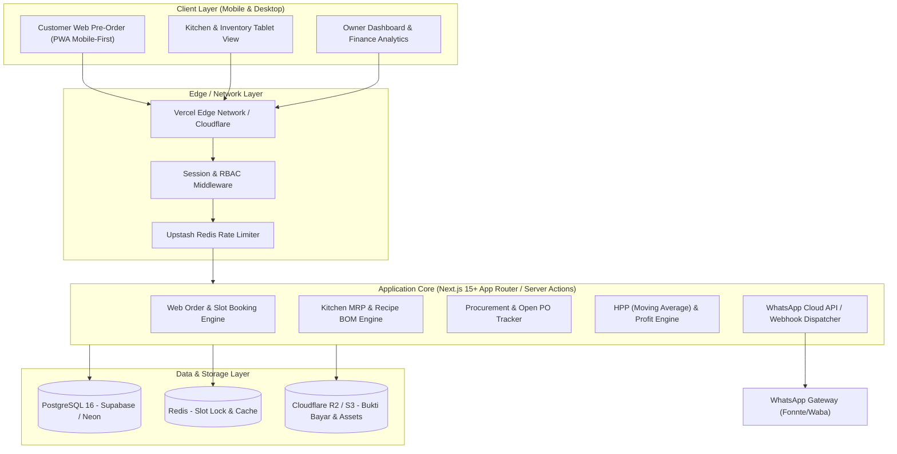
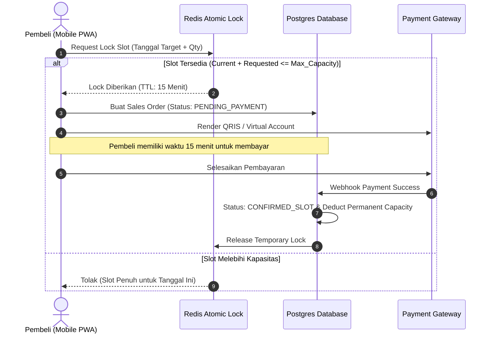

# System Architecture & Technical Specifications
## Project CISKEK: Web Pre-Order, MRP Kitchen Engine, Open PO & Profit Analytics

---

## 1. High-Level Architecture Overview

Aplikasi ini menggunakan pola arsitektur **Modular Monolith** dengan pendekatan **Offline-Tolerant Mobile-First Web Application (PWA) & Responsive Desktop Admin**.

---

## 2. Tech Stack Selection (Anti-Slop, High-Performance)

| Layer | Teknologi Terpilih | Justifikasi Teknis |
| :--- | :--- | :--- |
| **Framework** | **Next.js 15 (App Router, Server Actions)** | Server Components untuk SEO publik & Client Components untuk interaktivitas instan. |
| **Language** | **TypeScript 5.6+ (Strict Mode)** | Menghindari runtime bug pada kalkulasi HPP dan desimal rupiah. |
| **Styling** | **Tailwind CSS v4 + CVA (Class Variance Authority)** | Zero-runtime CSS, bundle ultra-kecil, konsisten dengan Design Tokens. |
| **UI Primitives** | **Radix UI Primitives + Lucide Icons** | Aksesibilitas WCAG penuh, unstyled, tanpa bloatware. |
| **Micro-Interactions** | **Framer Motion / Motion + Vaul (Drawer)** | Smooth spring animations ala Emil Kowalski, bottom sheets native feel di mobile. |
| **Database** | **PostgreSQL 16** | Integritas transaksi ACID untuk pemotongan slot dan stok BOM resep. |
| **ORM** | **Drizzle ORM** | Tipe data SQL aman (*type-safe*), zero overhead, migrasi transparan, tanpa bloat Prisma engine. |
| **State / Cache** | **Zustand (Client) + Upstash Redis (Server)** | Manajemen cart offline-ready dan distributed atomic lock untuk kuota slot tanggal. |
| **Validation** | **Zod** | Validasi skema input form dan tipe data payload API terpadu. |

---

## 3. Core Engine Pipelines

### 3.1 Slot Booking & Anti-Race Condition Engine
Slot pemesanan harian dibatasi oleh kapasitas oven (misal: 24 Bento / 12 Loyang Besar per hari).
Untuk mencegah **Double Booking** saat dua pelanggan checkout bersamaan di tanggal yang sama:

### 3.2 Automated MRP (Material Requirements Planning) Pipeline
Setiap hari pada jam cut-off (**16:00 WIB**), sistem mengeksekusi cron job MRP:
1. Agregasi seluruh pesanan berstatus `CONFIRMED_SLOT` untuk tanggal $H+1$ dan $H+2$.
2. Urai produk jadi ke komponen BOM:
   - 1 Slice Cake $\rightarrow$ 80g Keju, 44g Whipcream, 0.4 butir Telur, 46g Pondan, 20g Margarin.
   - 1 Bento Cake $\rightarrow$ 100g Keju, 55g Whipcream, 0.5 butir Telur, 57.5g Pondan, 25g Margarin, 1 Box Bento.
3. Bandingkan dengan `Current Physical Stock` di gudang.
4. Jika `Current Stock < Total Required`:
   - Otomatis terbitkan `Draft Purchase Order (PO)` ke supplier.
   - Beri notifikasi ke Purchasing / Kitchen via WhatsApp.

---

## 4. Security & Compliance
- **Audit Trails:** Setiap perubahan data inventori dan penyesuaian HPP dicatat di tabel `stock_ledger` dengan `user_id` dan `timestamp` yang *immutable*.
- **Role-Based Access Control (RBAC):**
  - `CUSTOMER`: Hanya bisa akses katalog pre-order dan status order miliknya via OTP WhatsApp.
  - `OWNER` *(Solo Operator)*: Akses penuh terpadu (All-in-One Dashboard: jadwal baking harian, checklist MRP bahan, pelacakan Open PO, dan analitik finansial laba rugi) yang dirancang untuk dioperasikan dengan cepat melalui satu layar ponsel atau tablet dapur.
