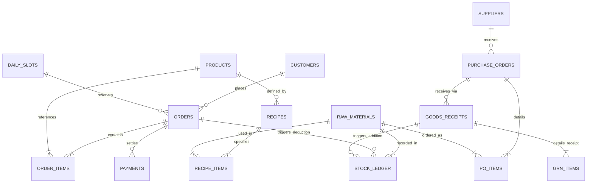

# Database Schema & Entity Relationship Diagram (ERD)
## Project CISKEK: PostgreSQL / Drizzle ORM Schema

---

## 1. Visual Entity Relationship Diagram (Mermaid ERD)



---

## 2. Definisi Tabel PostgreSQL (Production Drizzle Schema Ready)

### 2.1 Modul Master Produk & Bahan Baku (BOM Engine)

```sql
-- Satuan Standar: gram, butir, pcs, ml
CREATE TYPE unit_type AS ENUM ('GRAM', 'PIECE', 'ML');
CREATE TYPE product_variant AS ENUM ('SLICE', 'BENTO', 'WHOLE');
CREATE TYPE order_status AS ENUM ('PENDING_PAYMENT', 'CONFIRMED_SLOT', 'BAKING', 'READY_FOR_DELIVERY', 'DELIVERED', 'CANCELLED');
CREATE TYPE po_status AS ENUM ('DRAFT', 'SUBMITTED', 'PARTIALLY_RECEIVED', 'FULLY_RECEIVED', 'CLOSED');

-- Tabel Bahan Baku Mentah
CREATE TABLE raw_materials (
    id UUID PRIMARY KEY DEFAULT gen_random_uuid(),
    code VARCHAR(50) UNIQUE NOT NULL,          -- e.g. 'RAW-KEJU-CALF'
    name VARCHAR(255) NOT NULL,
    base_unit unit_type NOT NULL,             -- GRAM / PIECE
    current_stock NUMERIC(12, 3) DEFAULT 0,  -- 3 desimal untuk akurasi gram
    minimum_buffer NUMERIC(12, 3) DEFAULT 0,
    moving_avg_cost NUMERIC(12, 2) NOT NULL,  -- Nilai HPP per base_unit (e.g. 120.00/gram)
    last_purchase_price NUMERIC(12, 2) NOT NULL,
    storage_type VARCHAR(50) DEFAULT 'CHILLED', -- CHILLED / DRY / ROOM
    created_at TIMESTAMPTZ DEFAULT NOW(),
    updated_at TIMESTAMPTZ DEFAULT NOW()
);

-- Tabel Produk Jadi
CREATE TABLE products (
    id UUID PRIMARY KEY DEFAULT gen_random_uuid(),
    sku VARCHAR(50) UNIQUE NOT NULL,           -- e.g. 'CAKE-BENTO-10X7'
    name VARCHAR(255) NOT NULL,
    variant product_variant NOT NULL,
    selling_price NUMERIC(12, 2) NOT NULL,     -- e.g. 59000.00
    calculated_hpp NUMERIC(12, 2) NOT NULL,    -- Auto-calculated dari BOM (e.g. 31450.00)
    is_active BOOLEAN DEFAULT TRUE,
    image_url TEXT,
    created_at TIMESTAMPTZ DEFAULT NOW(),
    updated_at TIMESTAMPTZ DEFAULT NOW()
);

-- Resep (Bill of Materials Header)
CREATE TABLE recipes (
    id UUID PRIMARY KEY DEFAULT gen_random_uuid(),
    product_id UUID NOT NULL REFERENCES products(id) ON DELETE CASCADE,
    batch_yield NUMERIC(6, 2) DEFAULT 1.0,    -- 1 loyang = 5 slice (yield: 5.0)
    overhead_cost NUMERIC(12, 2) DEFAULT 0,   -- Biaya gas & listrik per batch (e.g. 8500.00)
    packaging_cost NUMERIC(12, 2) DEFAULT 0,  -- Biaya kemasan (box bento, mika slice)
    created_at TIMESTAMPTZ DEFAULT NOW()
);

-- Rincian Bahan Resep (BOM Items)
CREATE TABLE recipe_items (
    id UUID PRIMARY KEY DEFAULT gen_random_uuid(),
    recipe_id UUID NOT NULL REFERENCES recipes(id) ON DELETE CASCADE,
    raw_material_id UUID NOT NULL REFERENCES raw_materials(id),
    required_quantity NUMERIC(12, 3) NOT NULL, -- Kuantitas dalam base_unit (e.g. 100.000 gram keju)
    tolerance_waste_pct NUMERIC(5, 2) DEFAULT 2.0 -- 2% toleransi residu/ceceran di wadah
);
```

### 2.2 Modul Slot Pre-Order & Penjualan (Sales Engine)

```sql
-- Kalender Slot Kapasitas Oven Harian
CREATE TABLE daily_slots (
    id UUID PRIMARY KEY DEFAULT gen_random_uuid(),
    slot_date DATE UNIQUE NOT NULL,
    max_capacity_units INT NOT NULL DEFAULT 24, -- Maksimal ekuivalen bento cake per hari
    booked_units INT NOT NULL DEFAULT 0,
    is_locked BOOLEAN DEFAULT FALSE,            -- Ditutup jika cut-off 16:00 atau oven maintenance
    created_at TIMESTAMPTZ DEFAULT NOW()
);

-- Pelanggan (B2C & B2B)
CREATE TABLE customers (
    id UUID PRIMARY KEY DEFAULT gen_random_uuid(),
    phone_number VARCHAR(20) UNIQUE NOT NULL,  -- Login passwordless via OTP WhatsApp
    full_name VARCHAR(255) NOT NULL,
    address TEXT,
    customer_tier VARCHAR(50) DEFAULT 'RETAIL', -- RETAIL / RESELLER
    credit_limit NUMERIC(12, 2) DEFAULT 0,      -- Plafon piutang (untuk B2B)
    outstanding_balance NUMERIC(12, 2) DEFAULT 0,
    created_at TIMESTAMPTZ DEFAULT NOW()
);

-- Pesanan (Sales Order)
CREATE TABLE orders (
    id UUID PRIMARY KEY DEFAULT gen_random_uuid(),
    order_number VARCHAR(50) UNIQUE NOT NULL,   -- e.g. 'ORD-20261122-001'
    customer_id UUID NOT NULL REFERENCES customers(id),
    slot_date DATE NOT NULL REFERENCES daily_slots(slot_date),
    status order_status DEFAULT 'PENDING_PAYMENT',
    subtotal_revenue NUMERIC(12, 2) NOT NULL,
    total_hpp_cost NUMERIC(12, 2) NOT NULL,     -- Total HPP terkunci saat order dibayar
    gross_profit NUMERIC(12, 2) NOT NULL,       -- subtotal_revenue - total_hpp_cost
    shipping_fee NUMERIC(12, 2) DEFAULT 0,
    total_amount NUMERIC(12, 2) NOT NULL,
    payment_expiry TIMESTAMPTZ NOT NULL,        -- Now + 60 minutes
    notes TEXT,
    created_at TIMESTAMPTZ DEFAULT NOW()
);

-- Item Pesanan
CREATE TABLE order_items (
    id UUID PRIMARY KEY DEFAULT gen_random_uuid(),
    order_id UUID NOT NULL REFERENCES orders(id) ON DELETE CASCADE,
    product_id UUID NOT NULL REFERENCES products(id),
    quantity INT NOT NULL,
    unit_price NUMERIC(12, 2) NOT NULL,
    unit_hpp NUMERIC(12, 2) NOT NULL,           -- HPP snapshot saat transaksi dibuat
    total_revenue NUMERIC(12, 2) NOT NULL,
    total_hpp NUMERIC(12, 2) NOT NULL
);
```

### 2.3 Modul Pengadaan (Open PO & GRN Tracker)

```sql
-- Supplier Bahan Baku
CREATE TABLE suppliers (
    id UUID PRIMARY KEY DEFAULT gen_random_uuid(),
    code VARCHAR(50) UNIQUE NOT NULL,
    name VARCHAR(255) NOT NULL,
    contact_person VARCHAR(100),
    phone VARCHAR(20),
    lead_time_days INT DEFAULT 2,               -- Kecepatan kirim vendor (hari)
    created_at TIMESTAMPTZ DEFAULT NOW()
);

-- Purchase Order (PO)
CREATE TABLE purchase_orders (
    id UUID PRIMARY KEY DEFAULT gen_random_uuid(),
    po_number VARCHAR(50) UNIQUE NOT NULL,      -- e.g. 'PO-202611-004'
    supplier_id UUID NOT NULL REFERENCES suppliers(id),
    status po_status DEFAULT 'DRAFT',
    expected_delivery DATE NOT NULL,
    subtotal_amount NUMERIC(12, 2) NOT NULL,
    inbound_freight NUMERIC(12, 2) DEFAULT 0,   -- Biaya ongkir kargo supplier (Landed Cost)
    total_amount NUMERIC(12, 2) NOT NULL,
    notes TEXT,
    created_at TIMESTAMPTZ DEFAULT NOW()
);

-- Item PO
CREATE TABLE po_items (
    id UUID PRIMARY KEY DEFAULT gen_random_uuid(),
    po_id UUID NOT NULL REFERENCES purchase_orders(id) ON DELETE CASCADE,
    raw_material_id UUID NOT NULL REFERENCES raw_materials(id),
    ordered_qty NUMERIC(12, 3) NOT NULL,
    received_qty NUMERIC(12, 3) DEFAULT 0,      -- Akumulasi barang yang sudah datang
    unit_price NUMERIC(12, 2) NOT NULL
);

-- Good Receipt Note (GRN - Penerimaan Fisik di Kitchen)
CREATE TABLE goods_receipts (
    id UUID PRIMARY KEY DEFAULT gen_random_uuid(),
    grn_number VARCHAR(50) UNIQUE NOT NULL,     -- e.g. 'GRN-202611-009'
    po_id UUID NOT NULL REFERENCES purchase_orders(id),
    received_date TIMESTAMPTZ DEFAULT NOW(),
    received_by VARCHAR(100) NOT NULL,
    notes TEXT
);

-- Ledger Buku Besar Mutasi Stok (Immutable Audit Trail)
CREATE TABLE stock_ledger (
    id UUID PRIMARY KEY DEFAULT gen_random_uuid(),
    raw_material_id UUID NOT NULL REFERENCES raw_materials(id),
    transaction_type VARCHAR(50) NOT NULL,      -- 'GRN_IN' / 'BAKING_DEDUCT' / 'WASTE_SPOILAGE'
    reference_id UUID,                          -- ID dari order atau GRN
    quantity_change NUMERIC(12, 3) NOT NULL,    -- Positif (tambah) atau Negatif (kurang)
    resulting_stock NUMERIC(12, 3) NOT NULL,
    unit_cost_snapshot NUMERIC(12, 2) NOT NULL,
    created_at TIMESTAMPTZ DEFAULT NOW()
);
```

---

## 3. Database Indexes untuk Optimasi Performa
```sql
CREATE INDEX idx_orders_customer_id ON orders(customer_id);
CREATE INDEX idx_orders_slot_date ON orders(slot_date);
CREATE INDEX idx_orders_status ON orders(status);
CREATE INDEX idx_stock_ledger_material_id ON stock_ledger(raw_material_id);
CREATE INDEX idx_po_items_po_id ON po_items(po_id);
CREATE INDEX idx_daily_slots_date ON daily_slots(slot_date);
```
