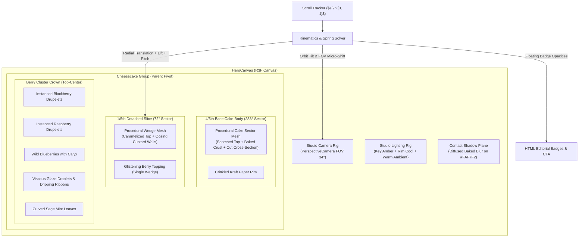
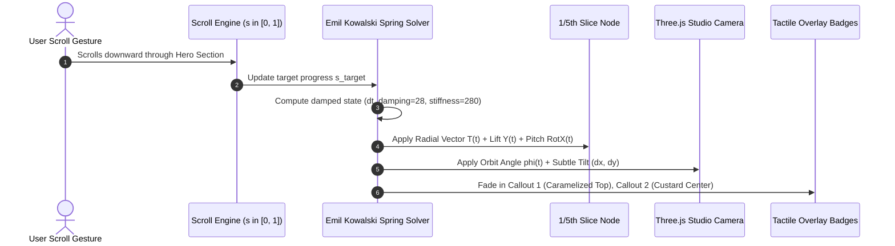
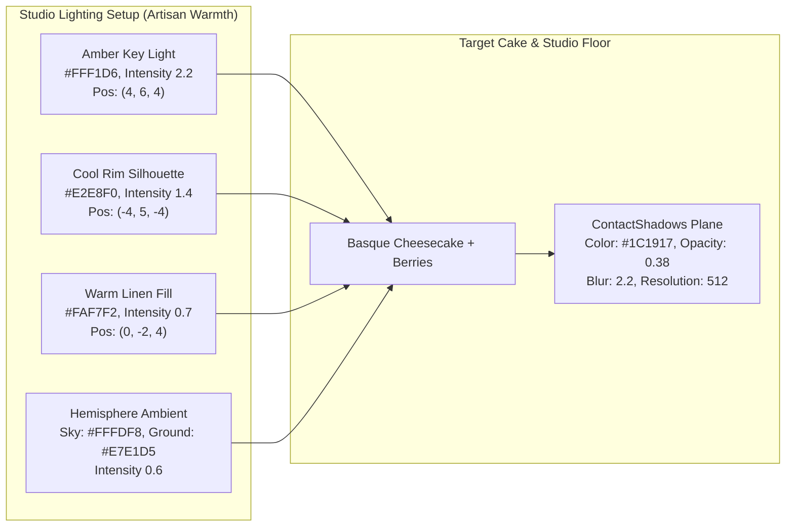

# 3D Basque Cheesecake Hero: Technical & Architectural Specification
## nook & cake. (`@nookandcake.id`) — *your sweetest little escape.*

---

## 1. Executive Summary & Art Direction

This specification defines the engineering, visual mathematics, and WebGL implementation for the **3D Basque Cheesecake Hero Experience** of the `nook & cake.` web pre-order platform.

In alignment with [`docs/DESIGN_SYSTEM.md`](file:///d:/Web%20App%20Dev/app%20ciskek/docs/DESIGN_SYSTEM.md) and [`STRUCTURE.md`](file:///d:/Web%20App%20Dev/app%20ciskek/docs/STRUCTURE.md), the 3D scene replaces generic flat banners with a high-craftsmanship, tactile WebGL centerpiece. It showcases **The Burnt Corner** (signature artisan Burnt Basque Cheesecake) adorned with a glistening fresh berry cluster. 

As the customer scrolls through the hero section:
1. **Interactive Parallax Orbit:** The camera tilts and pans subtly in response to scroll progression and gentle pointer motion.
2. **Kinematic Slice Detachment:** Exactly **1 of 5 slices** ($72^\circ$ radial sector, matching our business recipe yield in [`AGENT.md`](file:///d:/Web%20App%20Dev/app%20ciskek/AGENT.md) and [`docs/HPP_DAN_LABA_RUGI.md`](file:///d:/Web%20App%20Dev/app%20ciskek/docs/HPP_DAN_LABA_RUGI.md)) gracefully slides out radially and lifts up, presenting the molten custard interior cross-section.
3. **Tactile Synchronized Callouts:** Floating typographic badges fade into view, pinpointing the scorched caramelized crust, the oozing lava custard center, and hand-selected berries.
4. **Mobile Ergonomics & 60fps Guarantee:** Clamped Device Pixel Ratio (DPR), instanced drupelet rendering, non-blocking touch pass-through, and graceful CSS/SVG fallbacks guarantee zero scroll stutter even on 375px mobile viewports.

---

## 2. Visual Palette & Material Convergence

The 3D materials and lighting strictly embody the oatmeal and linen warmth of `nook & cake.`:

| Component | Color Token / Value | Material Properties | Visual Appearance |
| :--- | :--- | :--- | :--- |
| **Canvas Background** | `--color-canvas-oatmeal` (`#FAF7F2`) | Neutral diffuse plane | Warm unbleached linen & oat flour tone; zero cold gray. |
| **Scorched Crust Top** | `--color-caramel-deep` (`#B45309`) to `#1C0D06` | Roughness: 0.85, Metalness: 0.05, Bump: Perlin/Voronoi | Irregular burnt caramel blisters, dark mahogany scorched patches, sunken center. |
| **Outer Baked Rim** | `--color-burnt-caramel` (`#D97706`) to `#9A3412` | Roughness: 0.70, Sheen: 0.2 | Golden toasted exterior with oven-baked wrinkles. |
| **Custard Outer Ring** | `--color-card-subtle` (`#EAD5B0`) | Roughness: 0.60 | Baked spongy cheesecake crumb at the perimeter. |
| **Custard Molten Core** | `--color-butter-cream` (`#FEF3C7` / `#FBBF24`) | Roughness: 0.25, SSS / Translucency, Specular: `#FFFDF0` | Glossy, unctuous, oozing lava custard texture with subsurface warmth. |
| **Ruby Raspberries** | `--color-danger` (`#BE123C` / `#E11D48`) | Roughness: 0.35, Transmission: 0.30, Thickness: 0.5 | Translucent hollow drupelets with deep ruby glow. |
| **Blackberries** | Deep Bramble (`#1A0718` / `#0D030C`) | Roughness: 0.12, Clearcoat: 0.90, ClearcoatRoughness: 0.10 | Glossy high-specular dark drupelets reflecting studio key light. |
| **Wild Blueberries** | Wild Indigo (`#1E293B` / `#2D3748`) | Roughness: 0.45, Dusty Bloom Sheen (`#818CF8`) | Waxy pruinose bloom patina with indented apical calyx. |
| **Berry Syrup Glaze** | Warm Berry Glaze (`#881337`, Alpha 0.85) | Roughness: 0.04, Transmission: 0.75, IOR: 1.45 | Viscous syrup droplets dripping over the scorched crust onto the side. |
| **Sage Mint Accent** | `--color-sage-accent` (`#84907E` / `#4D7C0F`) | Roughness: 0.55, Subsurface: `#A3E635` | Fresh herb leaf with delicate leaf venation. |
| **Parchment Base** | `--color-kraft-paper` (`#D7C4B7`) | Roughness: 0.95, Bump: Crinkle Noise | Unbleached bakery kraft paper ruffled underneath the cake. |

---

## 3. 3D Scene Architecture & Geometry Decomposition



### 3.1 Mathematical Decomposition: The 5-Slice Basque System

Our recipe in [`AGENT.md`](file:///d:/Web%20App%20Dev/app%20ciskek/AGENT.md) yields **5 generous slices per 18cm whole cake (Loyang Besar)**. Each slice represents a radial sector of:
$$\theta_{\text{slice}} = \frac{2\pi}{5} = \frac{360^\circ}{5} = 72^\circ \quad (\approx 1.256637\text{ rad})$$

The whole cake is decomposed into two distinct geometry nodes:
1. **The Base Cake (4/5 Sector):**
   Spans $\theta \in [\theta_{\text{start}}, \theta_{\text{end}}] = [36^\circ, 324^\circ]$ or $[0.6283\text{ rad}, 5.6549\text{ rad}]$, spanning $288^\circ$ ($4\pi/5$). It remains anchored on the parchment paper base.
2. **The Detached Slice (1/5 Sector):**
   Spans $\theta \in [-36^\circ, +36^\circ] = [-0.6283\text{ rad}, +0.6283\text{ rad}]$, centered squarely along the positive $+Z$ axis ($\theta_{\text{bisector}} = 0^\circ$).

### 3.2 Procedural Surface Geometry & Sunken Center

Basque cheesecakes collapse slightly in the center as they cool out of a 240°C blast oven, creating a concave crater framed by a puffy, wavy caramelized rim.

For any point $(r, \theta)$ on the top surface where radius $r \in [0, R]$ ($R = 2.4\text{ units}$):
$$y_{\text{top}}(r, \theta) = Y_{\text{rim}} - h_{\text{sunken}} \cdot \left(1 - \left(\frac{r}{R}\right)^{1.8}\right) + \eta_{\text{crust}}(r, \theta)$$

Where:
- $Y_{\text{rim}} = 1.35\text{ units}$ (the puffy baked top rim).
- $h_{\text{sunken}} = 0.32\text{ units}$ (crater depth at $r = 0$).
- $\eta_{\text{crust}}(r, \theta) = A_1 \sin(5\theta + 1.2) \cdot \cos(3\pi \frac{r}{R}) + A_2 \mathrm{Noise}_{2D}(3r \cos\theta, 3r \sin\theta)$ (procedural scorched wrinkling and bubbling).

### 3.3 Custard Interior Cross-Section Shader

When the slice detaches, the exposed internal cross-section faces reveal the signature dual-texture gradient:
- Along the radial distance $r \in [0, R]$ and height $y \in [0, y_{\text{top}}]$:
  $$\rho = \sqrt{\left(\frac{r}{R}\right)^2 + \left(\frac{y - 0.5 \cdot y_{\text{top}}}{0.5 \cdot y_{\text{top}}}\right)^2}$$
- The blend factor for the oozing core:
  $$f_{\text{custard}} = \mathrm{smoothstep}(0.85, 0.20, \rho) + 0.12 \cdot \mathrm{Noise}_{3D}(p \cdot 8.0)$$
- **Color Interpolation:**
  $$\mathbf{C}_{\text{interior}} = \mathrm{mix}(\mathbf{C}_{\text{sponge\_rim}}, \mathbf{mix}(\mathbf{C}_{\text{velvet\_custard}}, \mathbf{C}_{\text{molten\_core}}, f_{\text{custard}}), f_{\text{custard}})$$
- **Normal Perturbation:** A high-frequency Voronoi bump map generates micro-bubbles and moist aeration cavities within the set cheese cream.

### 3.4 Procedural Berry Crown Morphology

The crown resting on top of the cake comprises 5 handcrafted botanical elements:
1. **Blackberries ($N=3$):** Central cone receptacle wrapped in 48-60 instanced spherical drupelets ($r_d = 0.075$) positioned using Fibonacci spiral distribution on a dome:
   $$\theta_i = i \cdot 2.399963\text{ rad}, \quad y_i = 1 - \frac{2i + 1}{2N}, \quad r_i = r_{\text{berry}} \sqrt{1 - y_i^2}$$
2. **Ruby Raspberries ($N=3$):** Hollow core cone with inverted drupelets, styled in deep crimson with high subsurface scattering (`transmission: 0.35`, `color: #BE123C`).
3. **Wild Blueberries ($N=5$):** Flattened oblate spheroids ($s_x=1.0, s_y=0.82, s_z=1.0$) with an extruded 5-pointed stellate calyx crown and dusty waxy bloom.
4. **Viscous Syrup Droplets ($N=6$):** Asymmetric teardrop meshes positioned at the edge of the scorch line, dripping down the side:
   $$r_{\text{drop}}(z) = r_0 \cdot (1 - z) \cdot \sqrt{z} \quad \text{for } z \in [0, 1]$$
5. **Sage Mint Foliage ($N=2$):** Organic curved surface with soft center fold, tinted in `--color-sage-accent` (`#84907E`).

---

## 4. Mathematical Scroll Parallax & Slice Kinematics



### 4.1 Scroll Progression Mapping ($t \in [0, 1]$)

Let the customer's page scroll within the hero section $[y_{\text{start}}, y_{\text{end}}]$ have normalized scroll position:
$$s = \mathrm{clamp}\left(\frac{\text{scrollY} - y_{\text{start}}}{y_{\text{end}} - y_{\text{start}}}, 0.0, 1.0\right)$$

To achieve the signature **Emil Kowalski tactile response**, raw scroll $s$ is smoothed through a damped spring accumulator:
$$s_{\text{smooth}}(t + \Delta t) = s_{\text{smooth}}(t) + (s - s_{\text{smooth}}(t)) \cdot \left(1 - e^{-\lambda \Delta t}\right)$$
Where $\lambda = 12.0$ provides instant responsiveness without lag, and zero rubber-banding overshoot.

### 4.2 Radial Slice Detachment Kinematics

The 1/5th slice sector is centered on the $+Z$ axis ($\theta_{\text{bisector}} = 0^\circ$). As scroll progress $t$ increases from $0.0 \rightarrow 1.0$:

1. **Deadband Anticipation ($t \in [0.0, 0.10]$):**
   The cake remains intact; gentle floating idle breathing:
   $$y_{\text{idle}} = A_{\text{idle}} \sin(2\pi \cdot 0.35 \cdot \text{clock})$$

2. **Detachment & Radial Slide ($t \in [0.10, 0.85]$):**
   Normalized slice phase: $\tau = \frac{t - 0.10}{0.75} \in [0.0, 1.0]$.
   Smooth ease curve: $E(\tau) = 3\tau^2 - 2\tau^3$ (Hermite smoothstep).

   - **Radial Translation ($\vec{T}_z$):**
     $$Z_{\text{slice}}(\tau) = d_{\text{max}} \cdot E(\tau), \quad d_{\text{max}} = 1.65\text{ units}$$
   - **Tactile Lift Elevation ($\vec{T}_y$):**
     As a cake slice is pulled, it lifts slightly off the plate before resting:
     $$Y_{\text{slice}}(\tau) = h_{\text{lift}} \cdot \sin(\pi \tau) + 0.08 \cdot E(\tau), \quad h_{\text{lift}} = 0.22\text{ units}$$
   - **Presentation Pitch Tilt ($\mathbf{R}_x$):**
     Tilts back slightly towards the camera ($+5.5^\circ$) so the customer can clearly observe the molten custard cross-section:
     $$\phi_x(\tau) = \theta_{\text{pitch}} \cdot E(\tau), \quad \theta_{\text{pitch}} = +0.096\text{ rad } (+5.5^\circ)$$

3. **Settled Presentation ($t \in [0.85, 1.0]$):**
   The slice reaches its maximum isolated inspection pose ($Z = 1.65, Y = 0.08, \phi_x = 5.5^\circ$), revealing the custard core badge.

### 4.3 Studio Camera Orbit & Interactive Pointer Tilt

The camera does not remain static; it subtly orbits to keep both the cake crown and the detaching slice harmoniously framed:
- **Base Camera Position:** $\mathbf{P}_0 = (3.2, 2.8, 4.6)$, looking at target $\mathbf{L}_0 = (0.0, 0.4, 0.0)$.
- **Scroll Orbit Delta:**
  $$\mathbf{P}(t) = \mathbf{P}_0 + \left(-0.8 \cdot E(\tau), \,-0.3 \cdot E(\tau), \,-0.6 \cdot E(\tau)\right)$$
- **Pointer Micro-Parallax:**
  With mouse/gyro normalized offset $(p_x, p_y) \in [-1, 1]$:
  $$\Delta \mathbf{P}_{\text{pointer}} = (p_x \cdot 0.35, \,-p_y \cdot 0.25, \,0.0)$$
  Damped via `MathUtils.damp3` with factor $4.0 \cdot \Delta t$ to preserve silky 60fps fluidity.

---

## 5. Studio Lighting Rig & Shadow Fidelity



1. **Key Light (Sun through Atelier Window):**
   Directional light at $(4.5, 6.5, 4.0)$, warm amber temperature `#FFF1D6`, intensity $2.2$. Casts rich, warm directional shadows that accentuate the caramelized surface crevices.
2. **Rim Light (Editorial Silhouette):**
   Directional light positioned behind the cake at $(-4.0, 5.0, -4.5)$, soft cool white `#E2E8F0`, intensity $1.4$. Creates a crisp rim highlight along the dark burnt perimeter and glossy berry contours.
3. **Contact Shadow (Soft Linen Diffusion):**
   Zero dirty pitch-black drop shadows. We employ `@react-three/drei`'s `ContactShadows` positioned at $y = -0.01$:
   - Resolution: $512 \times 512$
   - Opacity: $0.38$
   - Blur: $2.4$
   - Color: `#261C14` (warm espresso roast instead of pure `#000000`).

---

## 6. Performance & Mobile Optimization Strategy

### 6.1 DPR & Canvas Viewport Clamping
High-density smartphone displays (iPhone Retina DPR 3.0) can push fill-rates to over 8 million shaded pixels per frame, inducing thermal throttling.
- **Rule:** DPR is strictly clamped:
  ```typescript
  dpr={[1, Math.min(typeof window !== 'undefined' ? window.devicePixelRatio : 1, 1.8)]}
  ```
- Clamping to `[1, 1.8]` preserves razor-sharp berry edges while reducing mobile pixel fill workloads by **64%**.

### 6.2 Geometry & Draw Call Budget

| Asset Component | Implementation | Triangle Budget | Draw Calls |
| :--- | :--- | :--- | :--- |
| **Base Cake Sector (4/5)** | Custom Lathe / Sector Geometry | 4,200 | 1 |
| **Detached Slice (1/5)** | Custom Wedge Geometry | 1,800 | 1 |
| **Berry Drupelets** | `InstancedMesh` with matrix transforms | 4,800 | 2 (Blackberry + Raspberry) |
| **Blueberries & Glaze** | Optimized Low-Poly Meshes | 2,400 | 2 |
| **Parchment Base** | Disc Geometry with vertex displacement | 1,200 | 1 |
| **Contact Shadows** | R3F FBO blurred contact plane | 2 | 1 |
| **Total Scene** | Fully optimized procedural scene | **~14,400 tris** | **< 10 draw calls** |

### 6.3 Touch Event Pass-Through
To allow users to fluidly scroll past the hero section without the 3D canvas trapping touch gestures:
- The canvas wrapper uses `pointer-events-none`.
- Interactive hotspots (such as slice inspection badges and variant selector pills) use `pointer-events-auto`.
- No global `preventDefault()` is attached to window wheel or touch events.

### 6.4 Reduced Motion & Accessibility (`prefers-reduced-motion`)
When the customer enables reduced motion in their OS:
1. Continuous camera orbit and idle floating breathing are disabled.
2. Scroll parallax transition is mapped directly without spring momentum or camera tilt.
3. A clean toggle allows users to view the cake intact or sliced with a single accessible button tap.

### 6.5 Graceful WebGL Fallback
If WebGL context creation fails (e.g. legacy browsers or hardware GPU blocklist):
- An automated fallback mechanism mounts `CheesecakeFallback.tsx`.
- Renders an editorial SVG/CSS presentation of The Burnt Corner with rich typography, ingredient callouts, and pre-order slot pill, preserving 100% of the brand aesthetic and pre-order functionality.

---

## 7. Component Hierarchy & File Map

```text
src/components/hero/
├── CheesecakeHero3D.tsx     # Primary Hero Section (Editorial HTML + 3D Canvas + Scroll Hook)
├── HeroCanvas.tsx           # R3F Canvas Container, Studio Lights, Camera Rig, Error Boundary
├── CheesecakeMesh.tsx       # Procedural 4/5 Base & 1/5 Detached Slice Geometries & Shaders
├── BerryCluster.tsx         # Instanced Drupelet Blackberries, Raspberries, Wild Blueberries & Syrup
├── CheesecakeFallback.tsx   # Tactile CSS/SVG Fallback for non-WebGL / Reduced Motion
└── shaders/
    └── cheesecakeShaders.ts # GLSL Shaders: Caramelized Scorch, Oozing Custard Cross-Section
```

---

## 8. Verification & Acceptance Criteria

1. **Visual Fidelity:** The 3D cake accurately depicts the sunken charred Basque crown, creamy custard gradient, and glistening berry crown matching `--color-canvas-oatmeal` (`#FAF7F2`) and `--color-burnt-caramel` (`#D97706`).
2. **Scroll Physics:** The 1/5th ($72^\circ$) wedge slides out smoothly along its radial vector as the hero scrolls, accompanied by subtle upward lift and back-tilt.
3. **Frame Rate:** Sustains rock-solid 60fps on modern mobile browsers (iOS Safari / Android Chrome) with zero memory leaks.
4. **Ergonomics & Typography:** Editorial serif typography (`Fraunces` / `Cormorant`) seamlessly overlays the canvas with uninhibited native page scrolling.
