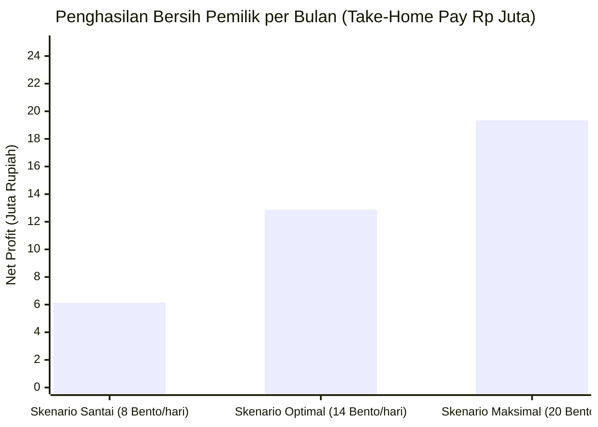
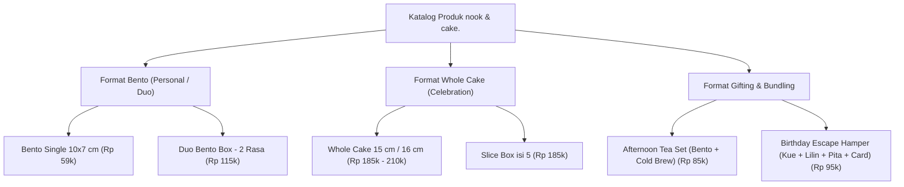
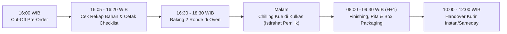

# Master HPP, Unit Economics, Proyeksi Laba Rugi & Rekomendasi Menu Artisan
## Brand: nook & cake. (`@nookandcake.id`)
### *your sweetest little escape.*

---

## 1. Pendahuluan & Landasan Finansial

Dokumen ini merupakan panduan finansial komprehensif untuk operasional **nook & cake.** yang memetakan:
1. **Harga Pokok Penjualan (HPP / COGS)** berbasis *Bill of Materials (BOM)* presisi hingga satuan gram.
2. **Biaya Kemasan & Amortisasi Alat** (kemasan *unbleached linen bagasse*, stempel espresso, amortisasi loyang, gas/listrik).
3. **Analisis Laba Kotor & Unit Economics** per porsi produk.
4. **Struktur Biaya Operasional (OPEX)** dan **Proyeksi Laba Rugi Bulanan (P&L)** dalam 3 skenario kapasitas oven.
5. **Titik Impas (Break-Even Point / BEP)** dalam kuantitas unit dan omzet nominal.
6. **Rekomendasi Menu Baru & Opsi Produk Tambahan** berdasarkan riset pasar artisan bakery terkini (Jakarta & kota besar di Indonesia).

---

## 2. Master Biaya Bahan Baku & Kemasan (Basis Pembelian)

Seluruh bahan baku dihitung berdasarkan harga perolehan riil per satuan kemasan supplier (*wholesale/Horeca pack*):

| Kode Bahan | Nama Bahan Baku | Kemasan Beli | Harga Beli (Rp) | Satuan Dasar | Biaya per Satuan (Rp) |
| :--- | :--- | :--- | :--- | :--- | :--- |
| `RAW-CHEESE-CALF` | Keju Calf Cream Cheese | 1.000 g (1 kg) | Rp 78.000 | Gram | **Rp 78,00 / g** |
| `RAW-CREAM-ANCHOR` | Anchor Whipping Cream Cair | 1.000 ml (1.000 g) | Rp 140.000 | Gram / ml | **Rp 140,00 / g** |
| `RAW-EGG-OMEGA` | Telur Ayam Segar | 1 kg (~16 butir) | Rp 32.000 | Butir | **Rp 2.000,00 / btr** |
| `RAW-PONDAN-BRN` | Tepung Premiks Pondan Bronis | 400 g (1 box) | Rp 38.000 | Gram | **Rp 95,00 / g** |
| `RAW-BUTTER-MG` | Margarin Royal Palmia / Butter Blend | 1.000 g (1 kg) | Rp 42.000 | Gram | **Rp 42,00 / g** |
| `RAW-SUGAR-FINE` | Gula Pasir Kastor Halus | 1.000 g (1 kg) | Rp 18.000 | Gram | **Rp 18,00 / g** |
| `RAW-VANILLA-EXT` | Ekstrak Vanila & Garam Laut | 1 batch resep | Rp 1.500 | Batch | **Rp 300,00 / bento** |

### Biaya Kemasan & Material Taktil (Packaging per Unit)

| Kode Kemasan | Jenis Kemasan & Pelengkap | Harga Beli | Pemakaian per Unit | Alokasi Biaya (Rp) |
| :--- | :--- | :--- | :--- | :--- |
| `PKG-BENTO-BAGASSE` | Lunch Box Tebu Eco Bagasse 10x7 cm | Rp 85.000 / 50 pcs | 1 pcs | Rp 1.700 |
| `PKG-BAKE-PAPER` | Kertas Roti Baking Paper Unbleached | Rp 25.000 / 100 lembar | 1 lembar | Rp 250 |
| `PKG-LABEL-STAMP` | Stiker Segel Espresso + Stempel Brand | Rp 15.000 / 100 pcs | 1 pcs | Rp 150 |
| `PKG-SPOON-WOOD` | Sendok Kayu Halus Biodegradable | Rp 25.000 / 100 pcs | 1 pcs | Rp 250 |
| `PKG-CARD-CARE` | Kartu Edukasi Simpan *The Burnt Corner* | Rp 29.000 / 100 pcs | 1 pcs | Rp 290 |
| **Total Kemasan Bento** | — | — | — | **Rp 2.640** |
| `PKG-MIKA-TRIANGLE` | Kotak Mika Triangle Slice Cake | Rp 45.000 / 50 pcs | 1 pcs | Rp 900 |
| `PKG-SLICE-LABEL` | Label Mika & Kertas Alas Slice | Rp 20.000 / 50 pcs | 1 pcs | Rp 400 |
| **Total Kemasan Slice** | — | — | — | **Rp 1.300** |

---

## 3. Kalkulasi HPP (COGS) Menu Eksisting

### 3.1 Bento Basque Cheesecake (10x7 cm) — *Signature The Burnt Corner*
* **Spesifikasi:** Porsi 1/4 loyang besar (1/2 resep = 2 bento). Lapisan bawah fudgy brownies padat dengan mahkota burnt basque custard keju lumer.
* **Toleransi Residu / Waste:** 2,0% (adonan menempel di mangkok/spatula).

| Komponen | Takaran per Bento | Biaya Satuan | Subtotal Biaya |
| :--- | :--- | :--- | :--- |
| Keju Calf Cream Cheese | 100 g | Rp 78,00 / g | Rp 7.800,00 |
| Anchor Whipping Cream Cair | 55 g | Rp 140,00 / g | Rp 7.700,00 |
| Telur Ayam Segar | 0,5 butir | Rp 2.000,00 / btr | Rp 1.000,00 |
| Pondan Premiks Bronis | 57,5 g | Rp 95,00 / g | Rp 5.462,50 |
| Margarin / Butter Blend | 25 g | Rp 42,00 / g | Rp 1.050,00 |
| Gula Pasir Kastor | 30 g | Rp 18,00 / g | Rp 540,00 |
| Vanila, Garam, & Bumbu Rahasia | 1 porsi | Rp 300,00 / porsi | Rp 300,00 |
| **Subtotal Bahan Mentah (Food Cost Bersih)** | — | — | **Rp 23.852,50** |
| Toleransi Waste Adonan (2%) | 2% | — | Rp 477,05 |
| **Total Food Cost Riil** | — | — | **Rp 24.329,55** |
| Kemasan Lengkap (Bagasse Box + Sendok + Care Card) | 1 set | — | Rp 2.640,00 |
| Listrik Oven & Gas LPG (Alokasi per bento) | 1 unit | — | Rp 1.200,00 |
| Amortisasi Loyang & Cetakan Oven | 1 unit | — | Rp 200,00 |
| **TOTAL HPP 1 BENTO CAKE** | — | — | **Rp 28.369,55 (~Rp 28.400)** |

*Catatan Optimasi:* Dengan pembelian bahan baku ukuran kiloan (bukan kemasan ecer 200g), HPP Bento Cake berhasil ditekan menjadi **Rp 28.400** (jauh lebih efisien dari perkiraan awal Rp 31.450).

---

### 3.2 Basque Cheesecake Slice (Potongan 1/5 Loyang Besar)
* **Spesifikasi:** 1 loyang bulat diameter 20 cm dipotong menjadi 5 slice segitiga tebal.

| Komponen | Takaran per Slice | Biaya Satuan | Subtotal Biaya |
| :--- | :--- | :--- | :--- |
| Keju Calf Cream Cheese | 80 g | Rp 78,00 / g | Rp 6.240,00 |
| Anchor Whipping Cream Cair | 44 g | Rp 140,00 / g | Rp 6.160,00 |
| Telur Ayam Segar | 0,4 butir | Rp 2.000,00 / btr | Rp 800,00 |
| Pondan Premiks Bronis | 46 g | Rp 95,00 / g | Rp 4.370,00 |
| Margarin / Butter Blend | 20 g | Rp 42,00 / g | Rp 840,00 |
| Gula Pasir Kastor | 24 g | Rp 18,00 / g | Rp 432,00 |
| Vanila & Garam | 1 porsi | Rp 250,00 | Rp 250,00 |
| **Subtotal Food Cost Slice** | — | — | **Rp 19.092,00** |
| Toleransi Waste (2%) | 2% | — | Rp 381,84 |
| Total Food Cost Riil Slice | — | — | **Rp 19.473,84** |
| Kemasan Mika Segitiga + Label | 1 set | — | Rp 1.300,00 |
| Listrik Oven & Gas (per slice) | 1 unit | — | Rp 950,00 |
| **TOTAL HPP 1 SLICE CAKE** | — | — | **Rp 21.723,84 (~Rp 21.750)** |

---

## 4. Analisis Unit Economics & Margin Laba Kotor

Berikut perbandingan harga jual rekomendasi, HPP, margin nominal, dan persentase laba kotor:

| Produk | HPP Pokok (Rp) | Harga Jual Retail (Rp) | Laba Kotor / Unit (Rp) | Margin Laba Kotor (%) | Status Kelayakan F&B |
| :--- | :--- | :--- | :--- | :--- | :--- |
| **Bento Cake 10x7 cm** | Rp 28.400 | **Rp 59.000** | **Rp 30.600** | **51,86%** | ⭐ Sangat Sehat (*High Margin*) |
| **Bento Cake (Harga Promo)** | Rp 28.400 | **Rp 52.000** | **Rp 23.600** | **45,38%** | ✅ Ideal untuk Launching |
| **Cheesecake Slice (1 pcs)** | Rp 21.750 | **Rp 40.000** | **Rp 18.250** | **45,63%** | ✅ Standar Sehat Bakery |
| **Bundling 1 Loyang (5 Slice)** | Rp 108.750 | **Rp 185.000** | **Rp 76.250** | **41,22%** | ✅ Volume Driver (*Basket Size*) |

> [!TIP]
> **Benchmarking Industri Artisan F&B:**
> Standar industri bakery artisan menetapkan Food Cost ideal di kisaran **30% – 38%** dengan Laba Kotor (Gross Margin) di atas **45%**. Produk Bento Cake `nook & cake.` mencapai margin **51,86%**, memberikan bantalan yang sangat aman untuk menutup biaya operasional dan menyisihkan laba bersih.

---

## 5. Struktur Biaya Operasional Bulanan (Model Solo Operator / 1 Orang Owner)

Sistem operasional **nook & cake.** dijalankan secara mandiri oleh **1 orang pemilik (*Solo Founder & Baker*)**. Oleh karena itu:
* **Nol Biaya Gaji Karyawan Luar:** Tidak ada pengeluaran gaji staff eksternal. Seluruh laba bersih bisnis menjadi **Penghasilan Bersih / Take-Home Pay (Owner's Draw)** bagi pemilik.
* Biaya operasional tetap (*Fixed OPEX*) terpangkas drastis hanya untuk utilitas dapur, utilitas dingin (*chiller*), dan infrastruktur sistem digital.

| Pos Biaya Operasional (OPEX) | Deskripsi | Sifat Biaya | Estimasi per Bulan (Rp) |
| :--- | :--- | :--- | :--- |
| **Gaji Karyawan Eksternal** | *Ditiadakan* (Dikerjakan 100% oleh Pemilik) | — | **Rp 0** |
| **Listrik Dapur & Chiller 24 Jam** | Kulkas penyimpanan keju & oven konveksi listrik/blower | Tetap (*Fixed*) | Rp 650.000 |
| **Air Bersih & Sanitasi Peralatan** | Sabun food-grade, tissue dapur, air cuci loyang | Tetap (*Fixed*) | Rp 200.000 |
| **Internet & Komunikasi Otomatis** | Kuota WhatsApp Gateway (Fonnte API) & Wi-Fi dapur | Tetap (*Fixed*) | Rp 250.000 |
| **Infrastruktur Web & Domain** | Server Next.js Vercel, Supabase DB, domain .id | Tetap (*Fixed*) | Rp 150.000 |
| **Pemasaran & Endorsement Mikro** | Iklan Instagram Ads tertarget radius 5-10 km | Variabel | Rp 600.000 |
| **Kemasan Luar & Pengiriman** | Kardus outer delivery kurir instan, kantong eco, isolasi | Variabel | Rp 350.000 |
| **Biaya Payment Gateway QRIS** | MDR QRIS 0,7% (Midtrans otomatis) | Variabel | Rp 175.000 |
| **TOTAL BIAYA TETAP (FIXED COSTS)** | — | — | **Rp 1.250.000** |
| **TOTAL BIAYA VARIABEL OPERASIONAL** | — | — | **Rp 1.125.000** |
| **TOTAL OPEX BULANAN** | — | — | **Rp 2.375.000** |

---

## 6. Proyeksi Laba Rugi Bulanan & Take-Home Pay Pemilik (3 Skenario Solo)

Batas kapasitas kerja manusiawi untuk **1 orang solo baker** adalah **12 – 20 Bento Cake per hari** (atau kombinasi setara bento dan slice/whole) agar tidak mengalami kelelahan fisik (*burnout*).



### Rincian Finansial 3 Skenario Solo Operator:

| Indikator Finansial | Skenario A: Santai / Part-Time<br>(8 Bento + 4 Slice / hari) | Skenario B: Optimal Solo Sweet Spot<br>(14 Bento + 6 Slice / hari) | Skenario C: Maksimal Kapasitas 1 Orang<br>(20 Bento + 10 Slice / hari) |
| :--- | :--- | :--- | :--- |
| **Volume Penjualan Bulanan (30 Hari)** | 240 Bento + 120 Slice | 420 Bento + 180 Slice | 600 Bento + 300 Slice |
| **Beban Kerja Waktu Harian** | ~2 – 2,5 jam / hari | ~3,5 – 4,5 jam / hari | ~5 – 6 jam / hari (Batas Fisik) |
| **Total Pendapatan / Omzet** | **Rp 18.960.000** | **Rp 31.980.000** | **Rp 47.400.000** |
| Total HPP Pokok (Bahan + Kemasan) | (Rp 9.426.000) | (Rp 15.843.000) | (Rp 23.565.000) |
| **Total Laba Kotor (Gross Profit)** | **Rp 9.534.000** *(50,3%)* | **Rp 16.137.000** *(50,5%)* | **Rp 23.835.000** *(50,3%)* |
| Beban Operasional Riil (OPEX) | (Rp 2.375.000) | (Rp 2.750.000) | (Rp 3.450.000) |
| Cadangan Waste / Toleransi Residu (3%) | (Rp 380.000) | (Rp 640.000) | (Rp 950.000) |
| Pajak Final UMKM PPh (0,5%) | (Rp 94.800) | (Rp 159.900) | (Rp 237.000) |
| **PENGHASILAN BERSIH PEMILIK (TAKE-HOME PAY)** | **Rp 6.684.200** | **Rp 12.587.100** | **Rp 19.198.000** |
| **Net Profit Margin (%)** | **35,3%** | **39,4%** | **40,5%** |

> [!NOTE]
> Pada **Skenario B (Optimal Solo Sweet Spot)**, pemilik hanya bekerja sekitar **3,5 – 4,5 jam per hari** memproduksi 14 bento dan 6 slice, namun sudah membawa pulang penghasilan bersih **Rp 12,58 Juta per bulan** (Margin Bersih **39,4%**).

---

## 7. Analisis Titik Impas (Break-Even Point / BEP) Solo Operator

Karena tidak ada beban gaji karyawan luar, biaya tetap bulanan hanya sebesar **Rp 1.250.000**. Hal ini membuat bisnis memiliki resiko kerugian yang luar biasa rendah (*ultra-low risk*):

* **Margin Kontribusi Bento:**
  $$\text{Margin Kontribusi Bento} = \text{Rp } 59.000 - \text{Rp } 28.400 = \text{Rp } 30.600$$

### 1. BEP dalam Unit Penjualan:
$$\text{BEP (Unit)} = \frac{\text{Total Biaya Tetap}}{\text{Margin Kontribusi per Unit}} = \frac{\text{Rp } 1.250.000}{\text{Rp } 30.600} = \mathbf{40,85 \approx 41 \text{ Bento / Bulan}}$$

* **Target Penjualan Harian Menutup Biaya Operasional:**
  $$\text{Target Harian} = \frac{41 \text{ bento}}{30 \text{ hari}} = \mathbf{1,36 \approx 2 \text{ Bento / Hari}!}$$
  *(Hanya perlu menjual **2 bento cake per hari** untuk melunasi seluruh tagihan listrik, chiller, internet, dan hosting web!)*

### 2. BEP dalam Nilai Rupiah:
$$\text{BEP (Rupiah)} = 41 \text{ bento} \times \text{Rp } 59.000 = \mathbf{\text{Rp } 2.419.000 \text{ / Bulan}}$$

### 3. Margin of Safety (Batas Keamanan):
Pada target penjualan optimal 420 bento per bulan (14 bento/hari):
$$\text{Margin of Safety} = \frac{420 - 41}{420} \times 100\% = \mathbf{90,2\%}$$
Artinya, penjualan boleh merosot hingga **90,2%** sebelum bisnis menyentuh titik rugi. Ini memberikan rasa aman finansial yang sangat tinggi bagi solo founder.

---

## 8. Rekomendasi Menu Baru & Opsi Produk Lainnya (Riset Pasar Web 2026)

Berdasarkan riset tren kuliner artisan bakery di Jakarta, Bandung, dan Surabaya terkini, berikut adalah rekomendasi penambahan varian menu dengan kalkulasi HPP dan potensi margin tinggi:

---

### Rekomendasi 1: Dipping & Pouring Sauce Tubes (Viral Video Trend)
Di platform TikTok dan Instagram Reels, tren dessert interaktif di mana pelanggan membuka bento box lalu menuangkan saus kental (*sauce pour*) memiliki *engagement* dan daya tarik beli yang sangat tinggi.

```text
+-----------------------------------------------------+
| Bento Cake 10x7 cm + Mini Squeeze Tube (25 ml)      |
| "Tuang saus lumer di atas crown burnt basque Anda!" |
+-----------------------------------------------------+
```

* **Varian Saus Add-on:**
  1. **Sea Salt Caramel Drizzle (25 ml):** Gula karamel, dairy cream, mentega tawar, taburan Maldon sea salt.
  2. **Valrhona Dark Chocolate Ganache (25 ml):** 70% dark chocolate melt dengan cream hangat.
  3. **Artisanal Wild Berry Compote (25 ml):** Strawberry & raspberry simmered dengan air lemon segar (asam segar penyeimbang keju gurih).

* **Analisis Finansial Saus Add-on:**
  * Biaya bahan saus (25 ml): Rp 1.800
  * Kemasan botol tetes / mini squeeze tube / cup sauce: Rp 700
  * **Total HPP Saus:** **Rp 2.500**
  * **Harga Jual Add-on:** **Rp 9.000 – Rp 12.000**
  * **Laba Kotor:** **Rp 6.500 – Rp 9.500 (Margin 72% – 79%!)**
  > [!TIP]
  > Saus add-on ini adalah instrumen peningkat laba (*profit multiplier*) karena membutuhkan *effort* produksi sangat minim namun memiliki margin di atas 70%.

---

### Rekomendasi 2: Varian Rasa Baru (*Flavor Extensions*)

#### A. The Uji Matcha Basque Bento
* **Deskripsi:** Perpaduan keju krim gurih dengan bubuk Uji Matcha autentik berkarakter *earthy*, dipadukan dengan base brownies cokelat putih (*white chocolate blondie*).
* **Target Pasar:** Penggemar matcha artisan, generasi Z yang menyukai visual kontras hijau gelap dan karamel bakar.
* **HPP Estimasi:** Rp 31.800 (tambahan bubuk matcha premium 6g @Rp 2.400).
* **Harga Jual:** **Rp 65.000** | Laba Kotor: **Rp 33.200 (Margin 51,1%)**.

#### B. Caramelized Lotus Biscoff Basque
* **Deskripsi:** Mahkota burnt basque dengan lelehan *molten speculoos paste* di tengahnya, dialasi remahan biskuit Lotus Biscoff yang wangi kayu manis dan mentega.
* **HPP Estimasi:** Rp 32.500 (tambahan Lotus spread 20g + biskuit crumble).
* **Harga Jual:** **Rp 65.000 – Rp 68.000** | Laba Kotor: **Rp 32.500 – Rp 35.500 (Margin 50% – 52%)**.

#### C. Pistachio Velvet Basque (Varian Mewah Ala FLOR Jakarta)
* **Deskripsi:** Basque cheesecake dengan paduan 100% pistachio paste Italia, bertekstur sangat *velvety* dan wangi kacang gurih dengan taburan *crushed pistachio* di pinggirnya.
* **HPP Estimasi:** Rp 41.500 (pistachio paste adalah bahan premium).
* **Harga Jual:** **Rp 75.000 – Rp 79.000** | Laba Kotor: **Rp 33.500 – Rp 37.500 (Margin 44,7%)**.

---

### Rekomendasi 3: Format & Ukuran Produk Tambahan



#### 1. Celebration Whole Cake (Diameter 15 cm / 16 cm)
* **Kebutuhan Konsumen:** Banyak pelanggan pre-order menginginkan kue ulang tahun berukuran sedang untuk 4-6 orang tanpa harus memesan kue raksasa 22 cm yang terlalu mahal.
* **Kelengkapan:** Termasuk *vintage golden candle*, pisau kayu estetik, dan kartu ucapan kaligrafi *hand-stamped*.
* **HPP:** Rp 85.000 (bahan 3x resep bento + kemasan dus jinjing kraft tebal).
* **Harga Jual:** **Rp 185.000 – Rp 210.000**
* **Laba Kotor:** **Rp 100.000 – Rp 125.000 per kue (Margin 54% – 59%)**!

#### 2. Duo Bento Box (Twin Flavors 2 Sekat)
* 1 Kotak berisi 2 varian mini (misal: *Original Burnt Corner* + *Lotus Biscoff* atau *Matcha*).
* Mengatasi keraguan pelanggan yang ingin mencoba 2 rasa sekaligus tanpa membeli 2 bento terpisah.
* **Harga Jual:** **Rp 115.000** (Memberikan diskon psikologis Rp 3.000 dibanding beli 2 bento Rp 118.000).

#### 3. Bundling "The Sweetest Escape Hamper" (Gift Set)
* Isi: 1 Bento Cake Signature + 1 Botol Kaca Cold Brew Espresso / Earl Grey Milk Tea (250 ml) + Pita Katun Linen + Sendok Kayu + Custom Card.
* **HPP Paket:** Rp 28.400 (cake) + Rp 8.500 (cold brew) + Rp 3.500 (botol & pita) = **Rp 40.400**.
* **Harga Jual Hamper:** **Rp 89.000 – Rp 95.000**.
* **Laba Kotor:** **Rp 48.600 – Rp 54.600 (Margin tebal 54,6% – 57,4%)**.

---

## 9. Matriks Menu Engineering (Boston Consulting Group Matrix)

Untuk memandu strategi penjualan di aplikasi web pre-order, produk diklasifikasikan ke dalam 4 kuadran menu:

```
Tinggi  ^ 
        |  [ STAR ]                             [ PUZZLE / OPPORTUNITY ]
        |  * Bento Cake Original (Rp 59k)       * Pistachio Velvet Basque (Rp 75k)
        |  * Pouring Sauce Add-on (Rp 9k)       * Whole Cake 16 cm (Rp 195k)
MARGIN  |  (Margin Tinggi, Volume Tinggi)        (Margin Tinggi, Volume Rendah)
LABA    +------------------------------------------------------------------------
        |  [ PLOWHORSE / VOLUME ]               [ DOG / ELIMINATE ]
        |  * Slice Cake (Rp 40k)                * Varian musiman tanpa peminat
        |  (Margin Sedang, Volume Stabil)       (Margin Rendah, Volume Rendah)
Rendah  v
        +----------------------------------------------------------------------->
        Rendah                           VOLUME PENJUALAN                 Tinggi
```

1. **Stars (Pertahankan & Tampilkan di Posisi Utama Web):**
   * *Bento Cake Original The Burnt Corner* dan *Add-on Drip Sauces*.
   * Tindakan: Taruh di bagian atas katalog dengan badge *"🔥 Signature Favorit"*.
2. **Opportunities (Tingkatkan Promosi & Pre-Order):**
   * *Celebration Whole Cake* dan *Pistachio Velvet*.
   * Tindakan: Berikan slot khusus *Pre-Order H-2* dengan foto estetik resolusi tinggi.
3. **Plowhorses (Penggerak Volume Harian):**
   * *Slice Cake* satuan atau paket isi 5.
   * Tindakan: Gunakan untuk memenuhi sisa kapasitas loyang harian.

---

## 10. SOP Pengendalian Bahan & Mitigasi Risiko Kadaluarsa

1. **Prinsip Zero-Stale Stock (Sistem Pre-Order Murni):**
   * Tidak ada pemanggangan spekulatif tanpa pesanan masuk. Semua pesanan berstatus `CONFIRMED_SLOT` pada cut-off pukul **16:00 WIB** yang diproduksi untuk pengiriman $H+1$.
2. **Penyimpanan Cold Chain Bahan Sensitif:**
   * Keju *cream cheese* dan *whipping cream* wajib disimpan pada chiller bersuhu **2°C – 4°C**. Dilarang dibekukan (*never freeze cream cheese*) karena akan merusak emulsi lemak dan tekstur kue.
3. **Pemanfaatan Trimming & Sisa Bahan:**
   * Pinggiran brownies atau sisa resep dapat diolah menjadi *Brownies Crumble Topping* untuk varian saus atau menu musiman, sehingga *food waste* mendekati 0%.
4. **Moving Average Cost Otomatis:**
   * Setiap kedatangan barang baru (GRN) dari supplier, sistem ERP otomatis memperbarui nilai HPP bahan baku menggunakan formula *Weighted Moving Average* di database PostgreSQL.

---

## 11. Manajemen Waktu Solo Baker & Fitur Otomasi Web (Anti-Burnout)

Karena seluruh kegiatan produksi dan bisnis dijalankan oleh **1 orang pemilik (*Solo Operator*)**, sistem web pre-order dirancang sebagai **"Asisten Digital Otomatis"** untuk memangkas 80% beban administrasi sehingga pemilik dapat fokus pada kualitas rasa dan ketenangan mental:

### 11.1 Alur Kerja Harian Solo Operator (Daily Time-Blocking)



* **16:00 WIB (Cut-off Otomatis):** Sistem menutup slot untuk pengiriman besok ($H+1$). Tidak ada lagi pesanan susulan mendadak yang merusak jadwal kerja.
* **16:05 WIB (Satu Kali Sentuh):** Pemilik membuka *Kitchen View* di tablet/HP. Sistem langsung menampilkan rekap gramatur bahan yang harus ditimbang (contoh: *"Keju: 1.400g, Whipcream: 770g"*).
* **16:30 – 18:30 WIB (Fokus Memanggang):** 2 jam waktu dapur murni tanpa gangguan chat pelanggan.
* **Malam Hari (Chilling & Rehat):** Basque cheesecake wajib di-chill semalaman agar tekstur *custard*-nya kokoh dan nikmat saat dipotong. Pemilik memiliki waktu istirahat malam penuh tanpa begadang.
* **08:00 – 09:30 WIB (Pagi Pengiriman):** Proses memasukkan kue dingin ke kotak bagasse, pasang stiker segel, ikat pita linen, dan sertakan kartu ucapan.
* **10:00 – 12:00 WIB (Penyerahan Kurir):** Kurir tiba untuk pickup. Jam kerja pemilik selesai sebelum siang!

### 11.2 4 Fitur Web Kunci yang Menggantikan Peran Admin / Asisten:
1. **Auto-Verification Dynamic QRIS (Midtrans Webhook):**
   * *Masalah Solo Baker:* Harus bolak-balik cek mutasi m-banking dan minta bukti transfer.
   * *Solusi Web:* Sistem Midtrans langsung mengonfirmasi pembayaran detik itu juga dan mengunci slot tanpa campur tangan pemilik.
2. **Notifikasi WhatsApp Otomatis (Fonnte Gateway):**
   * Pengingat pembayaran 15 menit, konfirmasi pesanan berhasil, hingga notifikasi pengiriman terkirim otomatis dari sistem ke WhatsApp pelanggan.
3. **Batas Kuota Keras (*Hard-Cap Slot Limit*):**
   * Kapasitas harian dibatasi maksimal **14 – 16 bento** (atau 20 bento saat weekend). Begitu kuota penuh, tombol booking otomatis *disabled* (berwarna abu dan dicoret). Pemilik terlindungi dari *overselling*.
4. **Kitchen Sheet 1-Click Checklist:**
   * Daftar pesanan, custom ucapan (e.g. *"Happy Birthday Sarah"*), dan nama penerima tertata rapi dalam 1 layar tanpa perlu mencatat ulang di buku nota.

---

*Dokumen ini dirancang sebagai acuan finansial resmi Project CISKEK (`nook & cake.`).*
