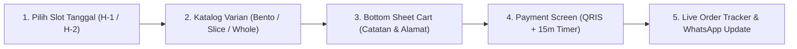

# Mobile-First UX Architecture & Screen Flows
## Project CISKEK: Fluid Mobile Experience for Customers & Kitchen Staff

---

## 1. Ergonomi Mobile & Prinsip Layout

Aplikasi web CISKEK didesain dengan filosofi **Mobile-First 100%**:
- **Thumb Zone Friendly:** 85% interaksi pelanggan dapat diselesaikan hanya dengan jempol satu tangan.
- **Zero Layout Shifts (CLS = 0):** Gambar produk dan badge memiliki rasio aspek terkunci (`aspect-ratio: 4/3` atau `1/1`).
- **Offline / Spotty Network Graceful:** Status pemesanan dan cart tersimpan di `localStorage` sehingga tidak hilang jika sinyal seluler pelanggan terputus saat memilih kue.

---

## 2. Customer Journey Screen Flows



---

### Screen 1: Date & Capacity Selector (Top Sticky Bar)
```
+------------------------------------------+
|  CISKEK BAKERY         [ 🛒 2 Item ]     |
|  Freshly Baked Basque Cheesecake         |
+------------------------------------------+
|  Pilih Tanggal Pengiriman / Pengambilan: |
|                                          |
|  +---------+  +---------+  +---------+   |
|  | Besok   |  | Lusa    |  | Jumat   |   |
|  | 23 Nov  |  | 24 Nov  |  | 25 Nov  | > |
|  | [4 Slot]|  | [Penuh] |  | [12 Slt]|   |
|  +---------+  +---------+  +---------+   |
|   (Active)     (Disabled)                |
+------------------------------------------+
```
- **UX Detail:** Pelanggan **wajib memilih slot tanggal terlebih dahulu** sebelum memasukkan kue ke keranjang. Ini mencegah frustrasi memilih kue namun slot tanggal ternyata sudah penuh saat checkout.

---

### Screen 2: Artisan Product Card (Bento Cake & Slice)
```
+------------------------------------------+
| +--------------------------------------+ |
| | [ Image 4:3 ]                        | |
| | Foto Bento Cake 10x7 dengan          | |
| | Lelehan Brownies & Keju              | |
| | Badge: "🔥 Favorit 1-2 Orang"        | |
| +--------------------------------------+ |
| Bento Cheesecake (10x7 cm)               |
| Perpaduan fudgy brownies & burnt cheese  |
|                                          |
| Rp 59.000             [ -  1  + ] Tambah |
+------------------------------------------+
| +--------------------------------------+ |
| | [ Image 4:3 ]                        | |
| | Foto Slice Cake                      | |
| | Badge: "🍰 Minimal 5 Slice / 1 Loyang"|
| +--------------------------------------+ |
| Cheesecake Slice                         |
| Potongan lembut siap santap              |
|                                          |
| Rp 40.000             [ + Tambah ]       |
+------------------------------------------+
```
- **UX Detail:** Tombol `[ - 1 + ]` bereaksi instan dengan tactile spring animation. Jika kuota harian tersisa 2, tombol `+` tidak bisa ditekan lebih dari 2 dan menampilkan pesan mikro *"Maksimal kuota tanggal ini tercapai"*.

---

### Screen 3: Bottom Sheet Checkout Drawer (Vaul Powered)
```
+------------------------------------------+
| =============== [ DRAG HANDLE ] ======== |
| Keranjang Pemesanan (Slot: Besok, 23 Nov)|
+------------------------------------------+
| 2x Bento Cheesecake           Rp 118.000 |
|    Catatan: "Tulis ucapan: HBD Sarah"    |
|                                          |
| Data Pengiriman:                         |
| [ Nama Lengkap: Budi Santoso          ]  |
| [ WhatsApp: 0812-3456-7890             ] |
| [ Alamat: Jl. Melati No. 12, Jaksel   ]  |
|                                          |
| Ringkasan Biaya:                         |
| Subtotal                     Rp 118.000  |
| Ongkos Kirim (Flat Kurir)     Rp  15.000  |
| Total Pembayaran             Rp 133.000  |
|                                          |
| [  🔒 BAYAR SEKARANG (QRIS / TRANSFER) ] |
+------------------------------------------+
```
- **UX Detail:** Drawer dapat digeser turun secara alami dengan sentuhan jempol untuk kembali memilih produk tanpa memuat ulang halaman (*zero page reload*).

---

### Screen 4: Payment Screen dengan Dynamic QRIS & Expiry Timer
```
+------------------------------------------+
|              CISKEK ORDER                |
|           No: ORD-20261123-004           |
+------------------------------------------+
| Selesaikan Pembayaran Dalam:             |
|                [ 14 : 42 ]               |
|          Slot Anda Ditahan Sementara     |
|                                          |
|       +-----------------------+          |
|       |                       |          |
|       |     [ QRIS CODE ]     |          |
|       |   Scan via GoPay/OVO  |          |
|       |      BCA / Mandiri    |          |
|       |                       |          |
|       +-----------------------+          |
|                                          |
| Total: Rp 133.000      [ Salin Nominal ] |
|                                          |
|  Atau Transfer Bank BCA:                 |
|  872-019-2811  a/n Ciskek Kitchen        |
|  [ Salin No Rekening ]                   |
|                                          |
| [ 📤 Upload Bukti Bayar (Opsional) ]     |
| [ 💬 Konfirmasi Cepat via WhatsApp ]     |
+------------------------------------------+
```

---

## 3. Kitchen & Production Tablet View (H-1 / Baking Day)

Tampilan khusus untuk staf dapur di area oven/chiller:
```
+-------------------------------------------------------------+
| JADWAL BAKING: RABU, 23 NOV 2026               [ 🖨️ Cetak ] |
| Total Pesanan: 14 Bento Cake | 4 Loyang Whole (20 Slice)    |
+-------------------------------------------------------------+
| REKAP KEBUTUHAN BAHAN OVEN (MRP):                           |
| [✓] Keju Calf: 3.000 gram (15 pack @200g)                   |
| [✓] Whipcream Cair: 1.650 gram                              |
| [✓] Telur Ayam: 15 butir                                    |
| [✓] Pondan Bronis: 1.725 gram (7.5 box)                     |
| [✓] Box Bento 10x7: 14 pcs                                  |
+-------------------------------------------------------------+
| DAFTAR ANTREAN PRODUKSI:                                    |
| #1 ORD-004 | 2x Bento (Custom: "HBD Sarah")   [ SIAP KIRIM ]|
| #2 ORD-007 | 1x Whole Cake Original           [ PROSES OVEN]|
| #3 ORD-009 | 4x Bento Cake                    [ DALAM CHILL]|
+-------------------------------------------------------------+
```
- **Fitur Cepat:** Staf dapur cukup menekan 1 tombol untuk mengubah status pesanan dari `DALAM CHILL` $\rightarrow$ `SIAP KIRIM`. Sistem otomatis mengirim notifikasi WhatsApp ke pelanggan: *"Kue Anda sudah matang dan siap diantar kurir! 🍰"*.
